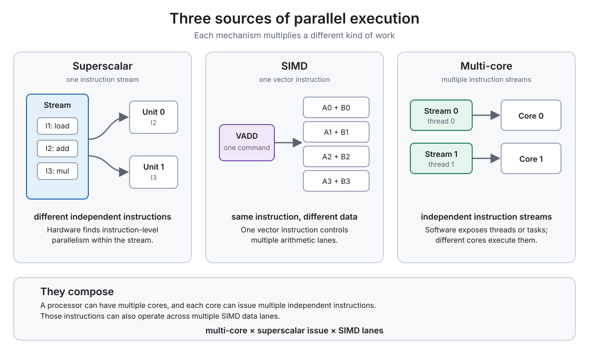

# Lecture 2 — A Modern Multi-Core Processor

**Status:** draft — awaiting owner review and reflection

This note follows the Fall 2023 CS149 lecture. The Fall 2025 offering divides
the material into Parts I and II, but retains the same central topics:
multi-core execution, SIMD, and hardware multithreading.

The question that organizes the lecture is:

> How does a modern processor find enough independent, ready work to keep its
> execution hardware busy?

## Lecture map

```text
                 MODERN PROCESSOR THROUGHPUT
                             |
                             v
             Keep execution resources busy
                             |
              +--------------+--------------+
              |                             |
              v                             v
      Find independent work          Supply operands
              |                       quickly enough
     +--------+--------+                    |
     |        |        |                    v
     v        v        v             MEMORY HIERARCHY
 SUPERSCALAR SIMD  INSTRUCTION       cache lines + locality
                    STREAMS        L1 -> L2 -> L3 -> DRAM
                      |                      |
                +-----+------+               |
                |            |               |
                v            v               |
            MULTI-CORE   HW THREADING         |
                |            |               |
                +------------+---------------+
                             |
                   Is useful work ready?
                       /             \
                     yes              no
                      |                |
                      v                v
              useful throughput      stall
                                       |
                        dependencies, divergence,
                        cache misses, bandwidth,
                        or no runnable thread
```

These mechanisms are complementary. A modern CPU may contain several cores;
each core may be superscalar, include SIMD units, and retain the execution
contexts of multiple hardware threads. Its cache hierarchy must also supply
the instructions and data that those execution resources need.

## From program to processor

### An instruction is not an instruction stream

An **instruction** is one machine-level command defined by the processor's
instruction set. It specifies an operation and its operands, such as loading a
value, adding registers, storing a result, or branching to another instruction.
A SIMD vector add is still one instruction even though it applies that command
to several data elements.

The executable contains **static instructions** at particular program
addresses. When a processor executes a static instruction, that occurrence is
a **dynamic instruction instance**. A loop can therefore execute the same
static instruction many times.

An **instruction stream** is the architecturally ordered flow of dynamic
instruction instances produced as one execution context's program counter
moves through the executable. Branches determine which instruction comes next,
and loops cause earlier instructions to appear again:

```text
static instructions in the executable

0x100: load
0x104: add
0x108: branch to 0x100

dynamic instruction stream

load -> add -> branch -> load -> add -> branch -> ...
```

The complete path from source code to execution is therefore:

```text
source program
      |
      v
compiler / toolchain
      |
      v
executable containing static instructions
      |
      v
thread + execution context (program counter and registers)
      |
      v
dynamic instruction stream
      |
      v
processor
```

| Single instruction | Instruction stream |
| --- | --- |
| One machine-level command | A sequence of dynamic instruction instances over time |
| May be scalar or vector | Contains loads, arithmetic, stores, branches, and other instructions |
| One static instruction can execute repeatedly | Repetition appears as multiple dynamic instances in the stream |
| Does not by itself represent a thread's progress | Is associated with one execution context and its changing state |

Two threads can execute the same static program code while producing separate
instruction streams because each thread has its own program counter and
register state. Conversely, a processor may execute independent instructions
from one stream out of order internally, but it must preserve the program's
architecturally required result.

### Processor state and components

A processor executes an instruction stream while maintaining program state. A
deliberately simple model has:

```text
instruction stream
        |
        v
  fetch / decode             control
        |
        v
 execution unit              computation
        |
        v
 registers / memory
```

- The **program counter** identifies the next instruction to fetch.
- **Registers** hold values directly available to instructions.
- **Fetch/decode and control logic** determine what operation should run.
- **Execution units**, such as ALUs, perform arithmetic or logical operations.
- **Load/store operations** move values between registers and memory.

An **execution context** is the state needed to continue one instruction
stream, including its program counter and registers.

### Instructions form a dependency graph

Program order is not the only constraint. One instruction may need a value
produced by another:

```text
load B --+
         +--> add --> A --+
load C --+              |
                         +--> multiply --> D
load E -----------------+
```

The processor must preserve the program's required semantics even if it
executes independent instructions in a different order. The dependency graph,
not merely the textual sequence, determines which instructions are ready.

Modern processors add execution units and retain more contexts, but extra
capacity is useful only when the processor can find operations whose inputs
are ready.

## Three sources of parallel execution

Superscalar execution, SIMD, and multi-core execution obtain parallel work
from different places:

```text
                         PARALLEL EXECUTION
                                  |
             +--------------------+--------------------+
             |                    |                    |
             v                    v                    v
        SUPERSCALAR              SIMD              MULTI-CORE
             |                    |                    |
  different independent    same instruction     separate instruction
  instructions             across data lanes    streams on different cores
             |                    |                    |
  one instruction stream   multiple data        streams may execute the
                           elements             same code on different data
             |                    |                    |
  hardware finds usable    programmer/compiler   software/runtime exposes
  ILP in the stream        exposes independence  threads or tasks;
                           hardware executes      hardware executes
             |                    |                    |
             v                    v                    v
  instruction-level        data-level           thread/task-level
  parallelism              parallelism          parallelism
```

The shortest way to retain the distinction is:

```text
superscalar multiplies instructions within one stream
SIMD        multiplies data elements covered by one instruction
multi-core  multiplies independently executing instruction streams
```

[](https://kalpak92.github.io/cs149-gpu-systems-lab/visualizations/processor-parallelism.html)

Select the diagram to open the interactive version. Each view animates once
when selected, and **Replay** repeats the current mechanism.

## Superscalar execution: parallelism within one stream

Consider:

```text
A = B + C
D = E * F
G = A + D
```

The first two instructions are independent:

```text
B + C ----> A --+
                +----> G
E * F ----> D --+
```

A superscalar core can issue or execute multiple independent instructions from
one instruction stream in the same cycle when dependencies and available
execution units permit it.

```text
             one instruction stream
                       |
                       v
              instruction selection
                  /           \
                 v             v
          execution unit  execution unit
```

This is **instruction-level parallelism (ILP)**. The hardware discovers the
usable ILP during execution. Out-of-order execution is a common mechanism for
finding ready instructions, but "superscalar" and "out of order" are not
synonyms: superscalar describes the ability to process multiple instructions
per cycle.

True dependencies still limit ILP:

```text
A = B + C
D = A * 2
E = D + 7
F = E * 3

A --> D --> E --> F
```

Adding execution units does not create independence in this chain. Hardware
can exploit parallelism that exists; it cannot remove a true data dependency.

## Memory abstraction and caches

The lecture pauses here because executing more instructions per cycle is useful
only when their operands can arrive quickly enough.

### The address-space abstraction

A program sees memory as a linear, byte-addressable array:

```text
address:  0x00  0x01  0x02  0x03  ...
value:     16    255    14     0   ...
```

A load names an address and asks for the value stored there. This programming
model does not expose whether that value is currently near the processor or
must be fetched from DRAM.

### A cache is a performance-oriented implementation detail

Focusing on data caches, a cache is small on-chip storage holding copies of a
subset of memory. For correct code in the simplified model used here, the
cache changes how long an access takes, not what value the load returns.

```text
processor
    |
    v
  cache  ---- miss ----> DRAM
    |
   hit
    |
    v
data reaches the execution unit sooner
```

- **Cache hit:** the requested data is already present in that cache.
- **Cache miss:** it is not present, so the request must continue to a farther
  cache level or to DRAM.
- **Eviction:** a cached line is removed to make room for another line.

### Caches move and store cache lines

Caches operate at the granularity of a **cache line**, not an individual byte.
If a toy cache has four-byte lines, loading address `0x0` brings the block
containing `0x0` through `0x3` into the cache:

```text
request 0x0 --> miss --> fetch line [0x0 0x1 0x2 0x3]
request 0x1 --> hit
request 0x2 --> hit
request 0x3 --> hit
```

This is why the access pattern matters even when the arithmetic does not
change. Four bytes is only the lecture's drawable toy example; the lecturer
uses a 64-byte Intel cache line as a real-machine example. Cache-line size is
an observed architectural property, not a universal constant.

### Addresses map to aligned cache lines

The low address bits select a byte within a line; the remaining part identifies
the aligned line containing that byte. With the lecture's four-byte toy lines:

| Byte addresses | Aligned line address |
| --- | --- |
| `0x0`–`0x3` | `0x0` |
| `0x4`–`0x7` | `0x4` |
| `0x8`–`0xB` | `0x8` |
| `0xC`–`0xF` | `0xC` |

This is address-to-cache-line mapping. It should not be confused with the
separate question of which cache set can hold a line; the lecture's initial
toy example uses an LRU replacement policy. The lecture mentions placement
restrictions while distinguishing miss types, but deliberately defers a full
treatment of set associativity and real cache design.

### Locality makes cache lines useful

- **Spatial locality:** after using one address, the program is likely to use
  nearby addresses. Fetching a whole line can satisfy those later accesses.
- **Temporal locality:** after using an address, the program is likely to use
  it again while its line is still cached.

Sequential array traversal often has good spatial locality. Reusing a small
working set can have good temporal locality. If a program fetches a line but
uses only some of its values, the unused bytes still consume transfer
bandwidth. Spatial locality therefore affects data movement as well as access
latency.

### Cache capacity is finite

The lecture distinguishes three reasons that requested data may be absent:

- **Cold (compulsory) miss:** the line has not been accessed before. Even an
  infinitely large cache would miss on this first access.
- **Capacity miss:** the line was fetched previously but was evicted because
  the cache could not retain the full working set.
- **Conflict miss:** the cache has enough total capacity, but its placement
  rules prevent the needed lines from residing together.

The lecture names conflict misses during discussion but does not develop the
cache organizations that produce them. For the processor performing the load,
all three are still misses: the data must be obtained from farther away.

```text
two-line cache

load line A --> [A]
load line B --> [A B]
load line C --> evict A --> [C B]
load line A --> miss again
```

Eviction can also cause data movement in the other direction. In a write-back
cache, an unmodified line can be discarded, while a modified or **dirty** line
must be written toward memory before its storage is reused.

The conclusion is not simply "caches are fast." Whether they help depends on
the relationship among line size, cache capacity, replacement, and the
program's access sequence.

### The cache hierarchy

A modern processor implements the memory abstraction with several cache
levels:

```text
registers -> L1 -> L2 -> L3 -> DRAM
             smaller/faster    larger/slower
```

The lecture's Kaby Lake example gives these illustrative—not universal—access
latencies:

| Data location | Approximate latency at 4 GHz |
| --- | ---: |
| L1 cache | 4 cycles |
| L2 cache | 12 cycles |
| L3 cache | 38 cycles |
| DRAM, best case | about 248 cycles |

A single load instruction may therefore trigger activity through multiple
cache levels before reaching DRAM. Caches can both shorten access latency and
provide higher bandwidth than distant memory, but a miss can still leave the
dependent instructions waiting for many cycles. The lecture contrasts the
roughly 4-cycle L1 hit with the roughly 248-cycle best-case DRAM access to show
why data placement can dominate a hoped-for four-core speedup. The exact
numbers are machine-specific; the large difference in scale is the point.

Larger and more distant storage also generally costs more energy per access.
The hierarchy is therefore an efficiency decision as well as a latency and
capacity decision.

Replicating memory values in multiple per-core caches raises a separate
correctness question: how do the copies remain coherent when a core writes?
The video explicitly notices this question and defers it. Cache coherence is a
later CS149 topic, not part of this cache-performance model.

## Running example: sine over an array

The lecture uses a function that approximates `sin(x)` with a Taylor expansion
for every element of an input array:

```text
for each i:
    y[i] = approximate_sine(x[i])
```

There are two different dependency stories inside this small program:

```text
Within one element:
term 1 --> term 2 --> term 3 --> ...
parts of the Taylor-series calculation depend on earlier values

Across elements:
x[0] --> y[0]
x[1] --> y[1]
x[2] --> y[2]
each array element can be computed independently
```

The inner computation may offer limited instruction-level parallelism, while
the outer array dimension exposes substantial data parallelism. Sequential
access to `x[i]` and `y[i]` also gives the cache spatial locality because
adjacent elements occupy the same or neighboring cache lines.

This one example is then mapped onto progressively different hardware:

```text
one scalar instruction stream
        -> superscalar core
        -> multiple cores / threads
        -> SIMD lanes
```

## Multi-core execution: parallelism across cores

The lecture frames multi-core as a transistor-allocation choice. A
pre-multi-core design could spend more chip area on a larger cache, more
sophisticated out-of-order logic, branch prediction, and prefetching to make
one instruction stream faster. Another choice is to duplicate cores so that
several instruction streams can run at once.

```text
more chip resources
      |
      +--> make one core more sophisticated
      |      larger cache, prediction, out-of-order machinery
      |
      `--> provide more cores
             more simultaneous instruction streams
```

A multi-core processor places multiple processing cores on one chip:

```text
                 processor
        +-----------+-----------+
        |           |           |
      core 0      core 1      core 2
```

Different cores can execute different instruction streams simultaneously.
Software exposes this work through threads or tasks, and the operating system
or runtime maps that work to cores.

```text
software identifies independent work
                 |
                 v
         creates threads or tasks
                 |
                 v
       runtime / OS schedules work
                 |
                 v
        cores execute the streams
```

This differs from superscalar execution:

- Superscalar hardware searches for independent instructions within a stream.
- Multi-core execution requires software to provide multiple instruction
  streams with useful work.

Duplicating cores does not automatically accelerate the original serial
`sinx` program. If the program exposes only one instruction stream, the other
cores have no part of that program to execute. Dividing the independent array
elements among threads—or expressing their independence with a parallel loop
construct—is what makes the additional cores useful.

### Express independence without fixing the core count

The explicit two-thread version of `sinx` divides the array in half, but that
implementation is tied to two instruction streams. The lecture's fictitious
`forall` construct expresses a higher-level fact instead:

```text
forall i in 0 .. N:
    y[i] = approximate_sine(x[i])
```

The programmer declares that iterations may run independently. A compiler or
runtime can then choose two, four, sixteen, or another appropriate number of
threads for the actual machine. This separates two responsibilities:

```text
programmer / programming model: expose valid independence
runtime / OS:                    map instruction streams to hardware
```

The declaration is a correctness promise. If iterations actually depend on
one another, scheduling them in parallel need not preserve the serial result.

The word **core** is also not a uniform unit across all processors. The video
shows a conventional multi-core CPU, GPU streaming multiprocessors, and
heterogeneous large and small CPU cores. These replicated units differ
substantially in their internal capabilities; counting them alone does not
provide a meaningful cross-architecture performance comparison.

## SIMD: one instruction across many data elements

The loop

```cpp
for (int i = 0; i < 8; i++)
    C[i] = A[i] + B[i];
```

contains the same operation over independent data elements. SIMD—single
instruction, multiple data—allows one instruction to control multiple
arithmetic lanes:

```text
                  vector ADD
                      |
       +------+-------+-------+------+
       v      v       v       v      v
      A0+B0  A1+B1   A2+B2   A3+B3  ...
```

### Scalar ADD versus vector ADD

A CPU's instruction set can define both **scalar** and **vector** forms of an
operation. A scalar ADD reads one value from each source operand and produces
one result:

```text
scalar registers

sA = A0
sB = B0

ADD sC, sA, sB

sC = A0 + B0
```

A vector register is wider and is interpreted as several fixed-size
**lanes**. For example, a 256-bit register can hold eight 32-bit floating-point
values. One vector ADD applies the same addition to corresponding lanes of two
vector operands:

```text
vector registers with eight 32-bit lanes

vA = [A0 A1 A2 A3 A4 A5 A6 A7]
vB = [B0 B1 B2 B3 B4 B5 B6 B7]

VADD vC, vA, vB

vC = [A0+B0 A1+B1 A2+B2 A3+B3 A4+B4 A5+B5 A6+B6 A7+B7]
```

`VADD` is one architectural instruction in the instruction stream, not eight
independently controlled ADD instructions. The processor fetches and decodes
that vector instruction, then the vector execution unit performs its
element-wise work across the lanes. The lanes share the operation; lane 0
cannot ADD while lane 1 independently MULTIPLIES as part of that same vector
instruction.

| Property | Scalar ADD | Eight-lane vector ADD |
| --- | --- | --- |
| Architectural instructions | One | One |
| Input elements per source operand | One | Eight |
| Results produced | One scalar result | Eight lane results in one vector register |
| Operation across elements | One addition | The same addition in every lane |

Vector loads normally place several adjacent elements into vector registers,
and vector stores write the resulting lanes back to memory. The vector ADD does
not by itself discover independent loop iterations; the programmer, compiler,
or programming model must establish that applying the operation across those
elements is valid.

Scalar versus vector describes **how many data elements one instruction
covers**. It is separate from superscalar issue width: a superscalar core may
issue several independent scalar instructions in one cycle, or may issue
multiple vector instructions when its dependencies and execution resources
permit.

One eight-lane vector instruction is also not a promise of an eightfold
speedup. Loads, stores, dependencies, incomplete vectors, instruction
throughput, and memory bandwidth can prevent all lanes from translating into
an equivalent workload speedup.

SIMD is efficient for coherent data-parallel work because fetch, decode, and
other control costs are shared across lanes. CPU vector instruction families
include AVX, AVX2, AVX-512, and ARM Neon.

### Explicit and implicit SIMD

In the terminology used by this lecture:

- **Explicit SIMD:** the compiled CPU binary contains vector instructions.
  The programmer may request them through intrinsics or parallel-language
  semantics, or the compiler may infer them through auto-vectorization.
- **Implicit SIMD:** the program is expressed as many scalar program instances,
  while the hardware executes the same instruction from a group of instances
  together on SIMD lanes.

The second model is an important bridge to GPUs. GPU literature also commonly
uses the term **SIMT** (single instruction, multiple threads); the exact mapping
from programming model to execution hardware depends on the architecture.

In the lecture's eight-wide CPU example, scalar variables become vector
registers, one vector instruction performs eight element-wise scalar
operations, and the loop advances by eight elements per iteration. Intrinsics
make that transformation visible but cumbersome. A higher-level parallel
language or vectorizing compiler can express or infer the same mapping without
requiring the application to spell out every vector register operation.

## Divergence: when lanes disagree about control flow

SIMD works best when the same instruction sequence applies to all active data
elements. Consider:

```cpp
if (x[i] > 0)
    A[i] = expensive_function();
else
    A[i] = cheap_function();
```

Different lanes may choose different paths:

```text
lane:       0 1 2 3 4 5 6 7
condition:  T T F T F F T T
```

The lanes do not independently execute unrelated instructions at the same
time. A common implementation executes each required control-flow path while
masking lanes that should not take that path:

```text
true path  --> T T - T - - T T
false path --> - - F - F F - -
```

Inactive lanes leave arithmetic capacity unused. Divergence can therefore
reduce SIMD utilization, although its exact cost depends on the generated code
and architecture. This is the conceptual precursor to GPU warp divergence.

For one control-flow path, a useful simplified measure is:

$$
\text{lane utilization} =
\frac{\text{active SIMD lanes}}{\text{physical SIMD lanes}}
$$

On an eight-wide unit, an expensive path needed by only one lane can execute
that path at $1/8$ lane utilization. The lecture also notes that some GPU
execution widths reach 32, making poor instruction-stream coherence
potentially more costly. This is not a prediction that all divergent programs
run at exactly $1/8$ or $1/32$ speed: total cost depends on which paths run,
their relative lengths, masking, and other bottlenecks.

## Returning to memory: cache misses can still stall execution

An arithmetic instruction cannot proceed until its input data is available:

```text
load data ---- long wait ----> data ready --> arithmetic
```

Caches reduce the length of many stalls, but they cannot guarantee that every
access hits. On a miss, the processor can try to find other independent
instructions from the same stream. Hardware prefetching may also predict
future accesses and bring data toward the processor before it is requested.
These mechanisms reduce or hide some access latency; they do not make DRAM
itself intrinsically faster.

Prefetching is most effective when the future address pattern is predictable,
such as sequential traversal. Pointer chasing, linked structures, and indexed
lookups whose next address depends on a just-computed value are harder to
predict early enough.

The throughput-oriented design creates a tension:

```text
more cores and SIMD lanes
        -> more operations per cycle
        -> more operands required per cycle
        -> more pressure on caches and memory
```

If chip area was obtained by simplifying per-core prediction machinery or
shrinking caches, misses may also become more likely. More arithmetic capacity
therefore raises the importance of supplying data; it does not make memory
latency or bandwidth disappear.

If no instruction in the current stream has ready operands, execution capacity
can remain idle even when the processor contains many ALUs. The next question
is whether another instruction stream has useful work that is ready now.

## Hardware multithreading: more candidate work per core

A hardware-multithreaded core retains multiple execution contexts. When one
thread waits for a long-latency operation, the core may issue ready
instructions from another thread.

```text
time ---------------------------------------------------->

thread A: compute  load ........ waiting ........ compute
thread B:              compute compute load ......
core:     A       A    B       B       B           A
```

This is not an operating-system context switch. The hardware contexts are
already resident in the core, allowing instruction selection at a much finer
granularity.

The linked video introduces the first behavior below and then stops. The
official slide deck continues the terminology and distinguishes both forms:

Two important forms are:

- **Interleaved multithreading:** the core chooses an instruction from one
  hardware thread in a cycle, then may choose another thread in a later cycle.
- **Simultaneous multithreading (SMT):** a superscalar core may issue
  instructions from multiple hardware threads in the same cycle. Intel
  Hyper-Threading is an example of SMT.

Hardware multithreading does not add arithmetic units and does not shorten the
latency of a memory operation. It provides more candidate instructions so the
existing units have a better chance of finding ready work.

It can also increase the completion time of an individual thread because that
thread now shares issue opportunities with other threads. The goal is not
necessarily to minimize one thread's latency; it is to finish more total work
by avoiding otherwise idle cycles.

Latency hiding therefore requires independent runnable work. If no resident
thread can make progress, the execution units stall. Adding threads also
cannot overcome a saturated memory-bandwidth limit, shared-resource
contention, or an unavoidable dependency.

## Latency and throughput are different

- **Latency:** how long one operation takes to complete.
- **Throughput:** how much total work completes per unit of time.

Hardware multithreading can increase throughput without reducing the latency
of the operation a particular thread is waiting for. Per-thread completion
latency may even increase:

```text
same load latency
       +
useful work from another thread during the wait
       =
higher utilization and potentially higher total throughput
but not necessarily lower latency for either thread
```

More concurrency helps only while it supplies useful work or enough
independent memory operations. Once an execution or bandwidth resource is
saturated, additional concurrency need not improve throughput.

## Putting the mechanisms together

A real processor can combine all four:

```text
CPU
|-- multiple cores
|   |-- superscalar instruction issue
|   |-- SIMD/vector execution units
|   `-- multiple hardware-thread contexts
`-- cache and memory hierarchy shared at different levels
```

The mechanisms provide execution capacity and ways to find work. Dependencies,
instruction-stream incoherence, cache misses, bandwidth, and contention
determine how much of that capacity becomes useful.

For a deliberately simplified arithmetic example, the mechanisms compose:

$$
\text{peak scalar operations per cycle}
=
\text{cores}
\times
\text{eligible instructions issued per core per cycle}
\times
\text{SIMD width}
$$

The lecture illustrates a four-core processor where each core can issue three
eight-wide vector operations, giving a theoretical peak of
$4 \times 3 \times 8 = 96$ scalar operations per cycle for a suitable
instruction mix. This is a capability calculation, not a performance
prediction. Dependencies, available instruction types and execution ports,
divergence, and data delivery can all prevent the workload from reaching it.

Hardware multithreading does not multiply that arithmetic peak because it does
not add ALUs. It increases the pool of candidate instructions that might keep
the existing ALUs occupied.

## Preview of the GPU and AI-infrastructure connection

A GPU is not simply a CPU with many tiny copies of a conventional CPU core. It
is a throughput-oriented design with many processing units, wide SIMD/SIMT-like
execution, and many resident thread contexts. When one group of threads waits,
the hardware can select other ready work—provided the workload exposes enough
independent work and is not already limited by another shared resource.

```text
data-parallel workload
        |
        v
many logical threads
        |
        v
grouped execution on SIMD/SIMT hardware
        |
        v
many resident contexts help hide latency
        |
        v
high throughput when work, data, and instruction paths cooperate
```

The same reasoning matters before work reaches the GPU. CPUs prepare batches,
decode and transform inputs, drive framework/runtime code, and initiate device
operations. A GPU can be idle even when it is technically usable if its host
pipeline does not supply work and data quickly enough.

These are architectural connections to carry into later experiments, not
measurements established by Experiment 00.

## Technical takeaways to verify in my own words

1. A program sees a linear address space, while the hardware serves accesses
   through a hierarchy of cache lines and DRAM.
2. Spatial and temporal locality improve the chance that an access hits in a
   nearby cache; finite capacity and eviction can turn reuse into a miss.
3. Prefetchers can help predictable access patterns, while pointer chasing and
   data-dependent indexed access are harder to predict.
4. Superscalar, SIMD, multi-core, and hardware multithreading obtain ready work
   from different places.
5. Higher-level constructs such as `forall` expose valid independence without
   hard-coding how many hardware threads or cores will execute it.
6. Additional execution hardware does not create independence in a dependency
   chain.
7. SIMD efficiency depends on instruction-stream coherence across lanes.
8. Core count, issue width, and SIMD width describe a theoretical arithmetic
   capability, not achieved workload performance.
9. Hardware multithreading hides latency by using another thread's ready work;
   it does not reduce the stalled operation's latency and may increase an
   individual thread's completion time.
10. More threads stop helping when they no longer add useful ready work or a
    shared execution or bandwidth resource is saturated.
11. Utilization depends on both available hardware and the workload's ability
    to feed it with ready instructions and data.

## Owner reflection — pending

These sections are intentionally incomplete. They should preserve the owner's
reasoning rather than presenting generated reflections as learned conclusions.

### What I think I understand

In my own words, what is the difference between superscalar execution, SIMD,
multi-core execution, and hardware multithreading?

> **Owner response:** pending

### What is unclear or counterintuitive

Which mechanism is least intuitive? Is the unclear part the cache-line and
locality model, superscalar execution, SIMD, multi-core execution, or hardware
multithreading? What specific claim, diagram, or example would I like to test
or explain more carefully?

> **Owner response:** pending

### Production / AI Infrastructure Connection

Where might one of these mechanisms or limits appear in an AI system—for
example, input preprocessing, batching, CPU-to-GPU submission, divergent GPU
work, or memory-bandwidth pressure?

> **Owner response:** pending

After these reflections are recorded, derive one narrow Experiment 01 question.
Do not attempt to measure superscalar execution, SIMD, multi-core scaling, and
hardware multithreading in one experiment.

## Source context

- [Stanford CS149 Fall 2023 course](https://gfxcourses.stanford.edu/cs149/fall23/)
- [Fall 2023 Lecture 2 video](https://www.youtube.com/watch?v=CKmNpAO5rS4)
- [Fall 2023 Lecture 2 slides: A Modern Multi-Core Processor](https://gfxcourses.stanford.edu/cs149/fall23content/media/multicore/02_basicarch_xX3ssOi.pdf)
- [Stanford CS149 Fall 2025 course](https://gfxcourses.stanford.edu/cs149/fall25/)

The full auto-generated transcript for the linked video was reviewed from
0:00 through 1:16:07. Because automatic captions contain repeated text and
recognition errors, the transcript was used to recover the spoken sequence and
emphasis, while terminology and examples were checked against the slides.
